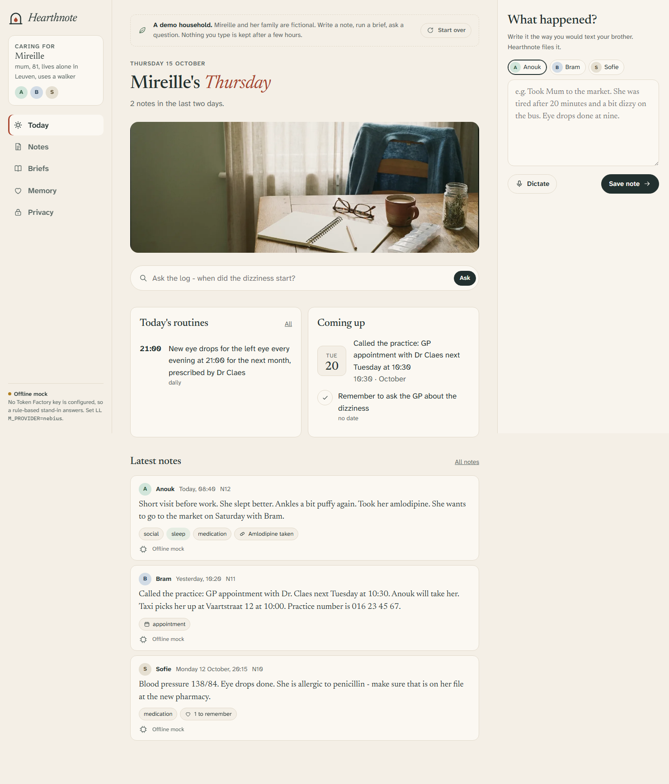

# Hearthnote

**A private notebook for families who look after someone at home.** Anyone in the care circle
writes what happened, the way they would text a sibling. Hearthnote turns those notes into
routines, reminders, a weekly family brief and questions for the GP. **NVIDIA Nemotron** open
models do the reading and reasoning on **Nebius Token Factory**, and names, addresses and phone
numbers are withheld before any text leaves the family's server.

Built from scratch for the [Nebius x NVIDIA Global AI Hackathon](https://nebiusglobalaihackathon.devpost.com/),
**Personal AI track**. MIT licensed. Made by [Rui Codex](https://ruicodex.com), Belgium.



## The problem

When a parent starts needing care, the information about them scatters: the daughter knows
about the new blood-pressure tablet, the son noticed she was unsteady on the stairs, the home
nurse wrote the eye-drop schedule on a sticky note. Nobody sees that the dizziness started two
days after the new tablet, and nobody remembers to ask the GP. In Belgium, 12.2 % of people aged
15 and over (more than a million) give informal care at least weekly (Sciensano, Health
Interview Survey 2018); in practice the coordination happens in group chats.

Generic assistants are the wrong shape for this. A family will not paste their mother's name,
address and medication list into a chatbot, and they should not have to.

## What it does

| | |
| --- | --- |
| **Write a note** | Free text or dictation, from any member of the circle. Saved instantly and checked offline for red flags (fall with a head injury, stroke signs, chest pain): if one fires, the app tells you to call 112 *before* any model is involved. |
| **Understand it** | Nemotron (fast tier) files the note into observations with a category and severity, medication changes, one-off tasks, repeating routines, appointments and facts worth remembering. Every item links back to its note. |
| **Memory with consent** | Long-term facts ("allergic to penicillin", "coffee with warm milk, never cold") and new routines are *proposed*; a person confirms, edits or forgets them. Only confirmed facts are used as context later. |
| **Skills** | Small declarative recipes in [`skills/`](skills/): *Weekly family brief*, *Prepare a doctor's visit*, *Medication change check*, *Handover for the next visit*. Families can write their own in the app ("Summarise mobility for the physiotherapist"). Every brief cites the notes it rests on. |
| **Ask the log** | "When did the dizziness start?" Local BM25 retrieval picks the relevant notes; only those (redacted) go to the model, which must answer from them and cite them. |
| **Reminders where people already look** | Active routines, appointments and dated tasks are published as a private iCalendar feed: subscribe once in Google Calendar, Outlook or an iPhone. No app to install for the brother in Ghent. |
| **Always on** | In a private install the weekly brief writes itself every Sunday at 18:00 (household timezone). |
| **Privacy you can see** | The *Privacy* page lists every request that left the server, with model, tokens, latency and the exact redacted prompt. |

## How it uses NVIDIA Nemotron on Nebius Token Factory

Two tiers, chosen per skill, exactly as the track suggests: the fast calls stay responsive and
cheap, the careful reasoning goes to the big model.

| Tier | Default model (configurable) | Used for | Reasoning |
| --- | --- | --- | --- |
| Fast | `nvidia/nemotron-3-super-120b-a12b` | Reading every note, handover, answering questions, quick custom skills | off (`enable_thinking: false`) |
| Deep | `nvidia/Nemotron-3-Ultra-550b-a55b` | Weekly brief, doctor's visit prep, medication change check | on |

- **OpenAI-compatible client, no SDK** ([`server/llm/provider.js`](server/llm/provider.js)):
  `POST https://api.tokenfactory.nebius.com/v1/chat/completions`.
- **Catalogue check at start-up**: `GET /v1/models` resolves both tiers to models that really
  exist; if a configured id disappears, the closest Nemotron is chosen instead of failing at the
  first note.
- **Structured output**: every skill has a JSON Schema (`response_format: json_schema`). The
  client degrades to `json_object`, then to prompt-only JSON, remembering per model which
  feature the endpoint accepted; one repair round if the output does not parse; a small
  validator coerces harmless drift. Reasoning text (`<think>` or `reasoning_content`) is
  stripped and never shown or stored.
- **Receipts**: every call records model, tier, tokens, latency and how many names were
  withheld. They appear under each note, each brief and in the ledger.
- **Credit protection** for the public demo: per-visitor and per-day call budgets.
- Live evidence: [`evidence/LIVE_CHECK.md`](evidence/LIVE_CHECK.md) (written by
  `npm run live-check`, at most 20 calls).

## The privacy model

1. **Names never leave.** People become `[P1]`, `[P2]` with a role ("daughter, visits most
   weekdays"); private words the family lists (a GP's name, a street) become `[PRIVATE1]`;
   phone numbers, e-mail, Belgian national register numbers, IBANs, street addresses and birth
   dates become placeholders. Answers are re-identified on the server
   ([`server/privacy/redact.js`](server/privacy/redact.js)).
2. **Only what a skill needs.** Each skill declares its context window and sources; *Ask*
   sends only the retrieved notes.
3. **Emergencies are not a model's job.** Red-flag rules run first, offline
   ([`server/privacy/safety.js`](server/privacy/safety.js)).
4. **The family's server, an encrypted vault.** Private mode keeps one household in an
   AES-256-GCM file (`HEARTH_VAULT_KEY`), behind a household passcode.
5. **No medical advice.** Prompts forbid diagnosis and dose suggestions; concerns become
   questions for the GP, nurse or pharmacist.

## Run it

Requirements: Node.js 22+. No npm dependencies.

```sh
npm test                       # 18 tests, offline
npm start                      # http://localhost:8080 - demo mode, offline mock if no key
```

Use Nemotron on Token Factory (the one-line switch is `LLM_PROVIDER`):

```sh
cp .env.example .env           # set NEBIUS_API_KEY, keep LLM_PROVIDER=nebius
node --env-file=.env server/main.js
```

Without a key, `LLM_PROVIDER=auto` (default) falls back to a deterministic rule-based mock and
the app says so in the sidebar.

### Modes

- `HEARTH_MODE=demo` (default): every visitor gets their own sandbox, seeded with a fictional
  household (Mireille, 81, and her family), kept in memory for three hours.
- `HEARTH_MODE=private`: one household, encrypted on disk, passcode-protected, weekly brief on
  a schedule. See [`docker-compose.example.yml`](docker-compose.example.yml).

### Docker

```sh
docker build -t hearthnote .
docker run -p 8080:8080 -e NEBIUS_API_KEY=... hearthnote                      # public demo
docker run -p 8080:8080 --env-file .env -e HEARTH_MODE=private -v hn:/app/data hearthnote
```

### Configuration

| Variable | Default | |
| --- | --- | --- |
| `LLM_PROVIDER` | `auto` | `nebius`, `mock` or `auto` |
| `NEBIUS_API_KEY` | - | Token Factory API key |
| `NEBIUS_BASE_URL` | `https://api.tokenfactory.nebius.com/v1/` | |
| `HEARTH_FAST_MODEL` / `HEARTH_DEEP_MODEL` | Nemotron 3 Super / Ultra | any model id in your catalogue |
| `HEARTH_FAST_THINKING` / `HEARTH_DEEP_THINKING` | `off` / `on` | |
| `HEARTH_MODE` | `demo` | `demo` or `private` |
| `HEARTH_VAULT_KEY`, `HEARTH_PASSCODE` | - | private mode |
| `HEARTH_TIMEZONE` | `Europe/Brussels` | weekly brief schedule and calendar feed |
| `TAVILY_API_KEY` | - | optional reference lookup for the medication check (only the medication name is sent) |
| `HEARTH_CALLS_PER_SESSION` / `HEARTH_CALLS_PER_DAY` | 40 / 1500 | demo budgets |
| `TRUST_PROXY_HEADER`, `HEARTH_SECURE_COOKIES` | - | behind a TLS reverse proxy |

## Architecture

```
browser (vanilla JS, strict CSP)
   |  JSON
server/main.js  node:http, static files, weekly scheduler
   |-- app.js              routes, budgets, demo sandboxes / private vault
   |-- care/skills.js      skill runner: context -> privacy gate -> Nemotron -> validate -> cite
   |-- care/household.js   notes, observations, medications, tasks, routines, memory
   |-- care/search.js      BM25 retrieval for "Ask"
   |-- care/ics.js         iCalendar feed
   |-- privacy/redact.js   names and identifiers out, back in
   |-- privacy/safety.js   offline red flags
   |-- llm/provider.js     Token Factory client (tiers, catalogue, JSON, receipts)
   |-- llm/mock.js         offline stand-in
   `-- store/vault.js      AES-256-GCM vault, demo sessions
skills/*.json             declarative skills
```

## Honest limits

- It is a notebook and a coordinator, not a medical device. It does not diagnose.
- The redactor is rule-based: it catches the names and words it has been told about and common
  identifier shapes. A nickname nobody listed will go through; the ledger makes that visible.
- Dictation uses the browser's speech recognition (on-device where the browser supports it).
- The demo household and every name in it are fictional.

## Credits

Design, imagery and video notes: [`design/STYLE_GUIDE.md`](design/STYLE_GUIDE.md),
[`design/GENERATED_ASSETS.md`](design/GENERATED_ASSETS.md), [`CREDITS.md`](CREDITS.md).
Product feedback for Nebius and NVIDIA: [`FEEDBACK.md`](FEEDBACK.md).
